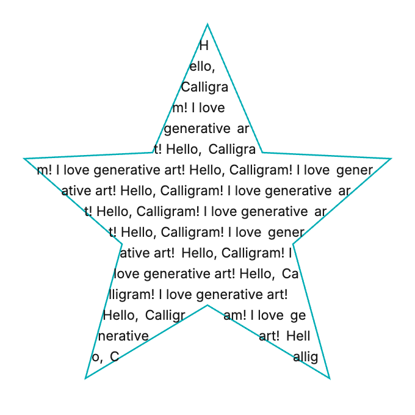
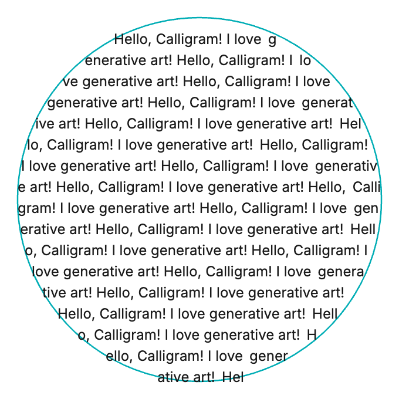
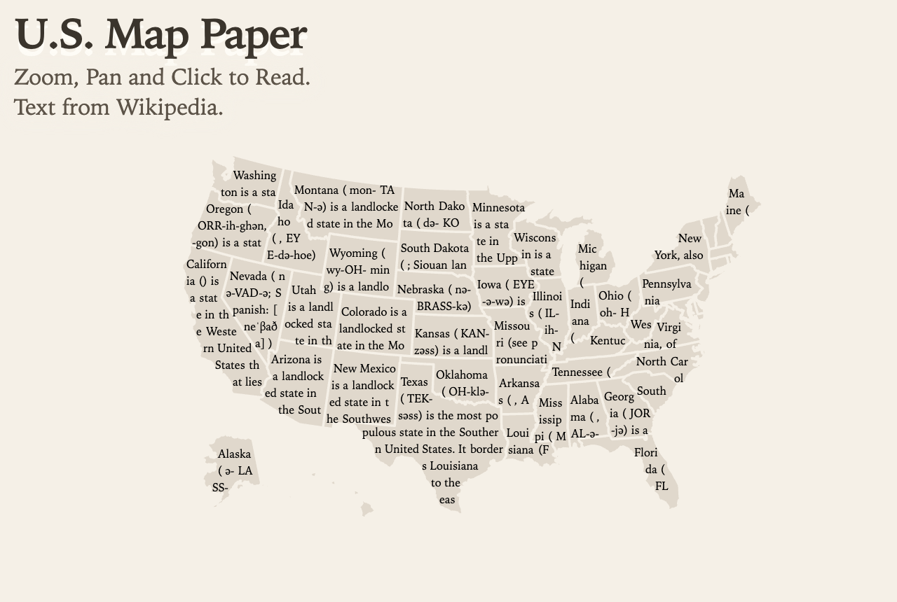
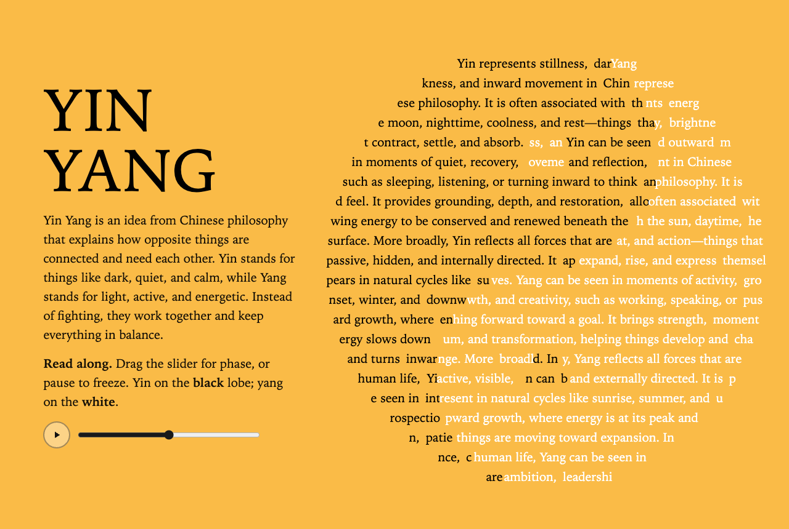
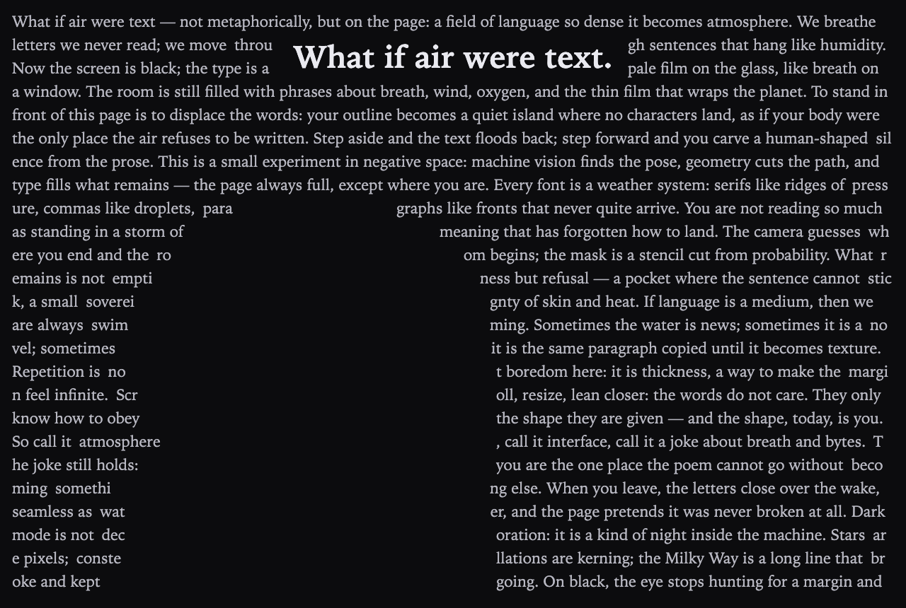
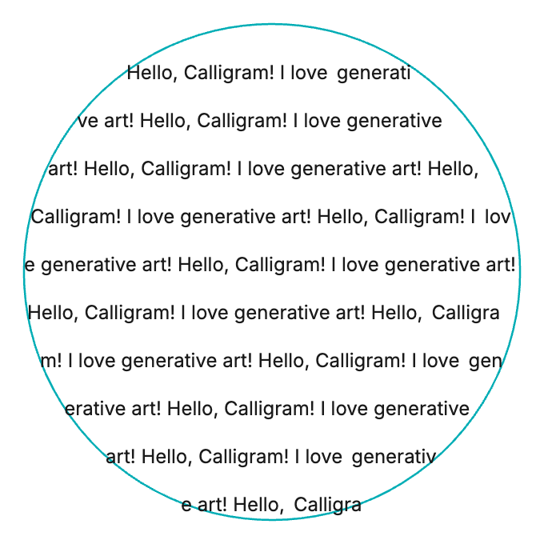
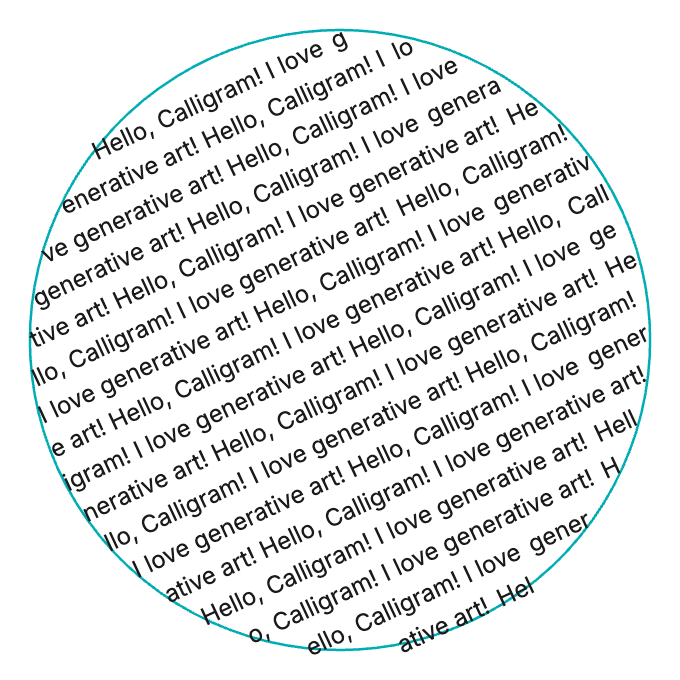
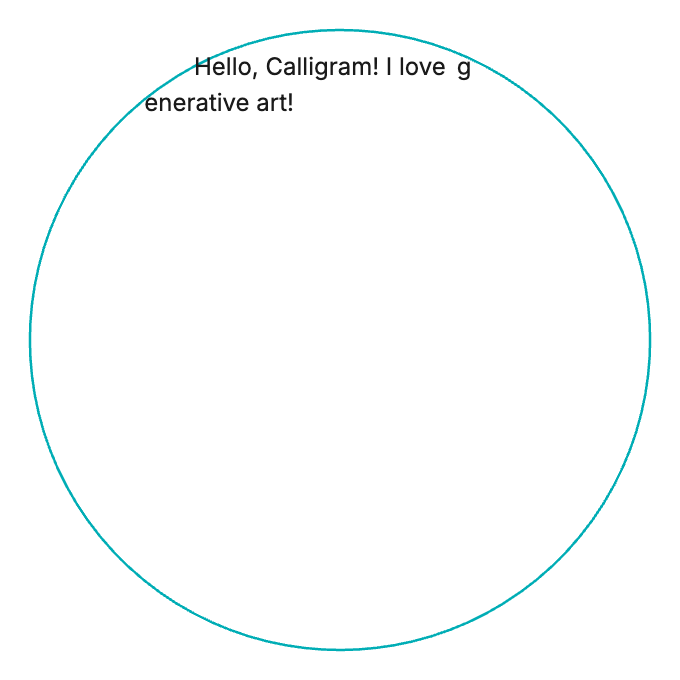

# Calligram

A **calligram** is text arranged so that it forms a shape. Calligram is a small library for
making them: it flows a string into a **closed** shape described by an SVG
[`d`](https://developer.mozilla.org/en-US/docs/Web/SVG/Attribute/d) path, built on top of
[Pretext](https://github.com/chenglou/pretext). Pure-arithmetic measurement and line breaking
keep it fast — there is no DOM layout and no reflow.

Calligram computes positions and leaves drawing to you, so it works with SVG, Canvas, plain DOM,
or anything else that can place a string at a point and an angle.



## Get started

Install it:

```sh
npm install calligram
```

Then give [`layoutTextInPath`](#layouttextinpathoptions) some text and a closed path, and draw
what it hands back:

```js
import {layoutTextInPath, pathCircle} from "calligram";

const path = pathCircle(170, 170, 155); // or any closed `d` string of your own

const layout = layoutTextInPath({
  text: "Hello, Calligram! I love generative art! ".repeat(6),
  path,
  fontSize: 12,
  fontFamily: "Inter",
});

const NS = "http://www.w3.org/2000/svg";
const svg = document.createElementNS(NS, "svg");
svg.setAttribute("viewBox", "0 0 340 340");

for (const t of layout.texts) {
  const node = document.createElementNS(NS, "text");
  node.setAttribute("text-anchor", "middle");
  node.setAttribute("dominant-baseline", "central");
  node.setAttribute("font-size", `${layout.fontSize}px`);
  node.setAttribute("font-family", layout.fontFamily);
  node.setAttribute("transform", `translate(${t.x}, ${t.y}) rotate(${t.angle})`);
  node.textContent = t.text;
  svg.append(node);
}

document.body.append(svg);
```



One catch worth knowing up front: measurement goes through the canvas, so a **web font must be
loaded before you call `layoutTextInPath`**, or it will measure the fallback face and the
fragments will overlap once they render in the real one.

```js
import {cssFont} from "calligram";

const font = {fontSize: 12, fontFamily: "Inter"};
await document.fonts.load(cssFont(font)); // the exact string the layout measures with
```

## Demos

Three demos run at **[calligram.bairui.dev](https://calligram.bairui.dev)**. The source is in
[`demo/`](./demo) — run them locally with `npm install && npm run dev`.

### [U.S. Map Paper](./demo/us-map-paper)

An interactive U.S. map where each state is filled with its own description.



### [Yin Yang](./demo/yin-yang)

An animated yin–yang symbol, each lobe filled with its own text and morphing as it turns.



### [Air Text](./demo/air-text)

A screen of text you interact with using your body, through a webcam: your silhouette becomes a
hole in the prose.



## Computing layout

Call [`layoutTextInPath`](#layouttextinpathoptions) with a string and a **closed** path. It
returns `texts` (the fragments to draw, with positions and angles), `lines` (the hachure
segments the text was laid along, useful for debugging), and the font fields and `path` you
passed in.

```js
const layout = layoutTextInPath({
  text: "Hello, Calligram! I love generative art!",
  path,
  fontSize: 12,
  fontFamily: "Inter",
});
```

Each item in `layout.texts` has `text`, `x`, `y` and `angle` (in degrees).

## Rendering with Canvas

Apply the transform to the context before drawing each fragment.

```js
const canvas = document.createElement("canvas");
canvas.width = 400;
canvas.height = 300;

const context = canvas.getContext("2d");
context.fillStyle = "#222";
context.font = `${layout.fontSize}px ${layout.fontFamily}`;
context.textAlign = "center";
context.textBaseline = "middle";

for (const t of layout.texts) {
  context.save();
  context.translate(t.x, t.y);
  context.rotate((t.angle * Math.PI) / 180);
  context.fillText(t.text, 0, 0);
  context.restore();
}
```

## Rendering with SVG

Bind `texts` to `<text>` nodes and use `transform` for position and rotation. With
[d3](https://d3js.org/):

```js
import * as d3 from "d3";

const svg = d3.create("svg").attr("width", 340).attr("height", 340).attr("viewBox", "0 0 340 340");

svg
  .selectAll("text")
  .data(layout.texts)
  .join("text")
  .attr("text-anchor", "middle")
  .attr("dominant-baseline", "central")
  .attr("font-size", `${layout.fontSize}px`)
  .attr("font-family", layout.fontFamily)
  .attr("transform", (d) => `translate(${d.x}, ${d.y}) rotate(${d.angle})`)
  .text((d) => d.text);
```

## Setting line height

Pass **`lineHeight`** to change the spacing between lines. The default is `fontSize * 1.5`.

```js
const layout = layoutTextInPath({
  // ...
  lineHeight: 30,
});
```



## Rotating text

Pass **`angle`** (in degrees) to rotate the direction the fill lines run, which changes how the
text follows the shape.

```js
const layout = layoutTextInPath({
  // ...
  angle: 25,
});
```



## Disabling repetition

By default, when the text runs out the cursor resets and layout continues, cycling until the
shape is full. Set **`repeat`** to `false` to stop instead — useful when you have enough text to
fill the shape once.

```js
const layout = layoutTextInPath({
  // ...
  repeat: false,
});
```



## Preparing explicitly

By default `layoutTextInPath` prepares your string from the given font options and memoizes that
work by text and font settings. As long as those stay the same, you can call it again with a new
`path` (or other options) without remeasuring the string.

If you would rather avoid that machinery — or you want to reuse one prepared value yourself —
call [`prepareText`](#preparetexttext-options) and pass the result as **`prepared`**.

```js
import {layoutTextInPath, prepareText} from "calligram";

const prepared = prepareText(longText, {fontSize: 14, fontFamily: "Inter"});

const layout = layoutTextInPath({text: longText, prepared, path});
```

## How it works

First the path is turned into polylines with
[`points-on-path`](https://github.com/pshihn/points-on-path). Then
[`hachure-fill`](https://github.com/pshihn/hachure-fill) generates parallel line segments inside
the shape at `lineHeight` spacing, optionally rotated by `angle`. Finally, along each segment,
Pretext's `layoutNextLine` fills the available width with text from the prepared string.

Those segments are the `lines` the layout returns — and they are what the logo above is drawing.
That is the whole idea, and it is about sixty lines of code: see
[`src/layoutTextInPath.js`](./src/layoutTextInPath.js). Suggestions and feedback are welcome.

## API

### layoutTextInPath(options)

Computes text positions with the specified options.

- **text** — source string (required).
- **path** — closed SVG path `d` (required).
- **fontSize** — default `16`.
- **fontFamily** — default `"Inter"`.
- **fontStyle** — default `"normal"`.
- **fontVariant** — default `"normal"`.
- **fontWeight** — default `"normal"`.
- **prepared** — optional prepared object from `prepareText`.
- **lineHeight** — spacing between lines; default `fontSize * 1.5`.
- **angle** — rotation of the fill lines in degrees; default `0`.
- **repeat** — whether to loop the text to fill the shape; default `true`.

Returns an object with:

- **texts** — the fragments to draw, each with `text`, `x`, `y`, `angle` and `lineHeight`.
- **lines** — the hachure segments, as `[[x1, y1], [x2, y2]]`.
- **path** — the input `d` string.
- **fontSize**, **fontFamily**, **fontStyle**, **fontVariant**, **fontWeight** — the effective
  values used for the layout.

### prepareText(text, options)

Builds a Pretext **prepared** value with the specified options.

- **fontSize** — default `16`.
- **fontFamily** — default `"Inter"`.
- **fontStyle** — default `"normal"`.
- **fontVariant** — default `"normal"`.
- **fontWeight** — default `"normal"`.
- Any extra keys are forwarded to Pretext's `prepareWithSegments`.

The return value includes Pretext's fields plus the five font fields, for convenience.

```js
const prepared = prepareText("Measure me", {fontSize: 16, fontFamily: "Inter"});
```

### clearTextCache()

Clears Calligram's memoized `prepareText` cache and Pretext's global `clearCache()`. Call it in
long-running apps or tests if you need to free memory or reset measurement state.

```js
clearTextCache();
```

### Path helpers

`layoutTextInPath` needs a **closed** path, so these build the usual ones. Each returns a plain
`d` string you can also hand to a `<path>` element or a `Path2D`.

- **pathCircle(cx, cy, r)**
- **pathEllipse(cx, cy, rx, ry)**
- **pathRect(x, y, width, height)**
- **pathPolygon(points)** — `points` as `[[x, y], …]`; the ring is closed for you.

```js
import {pathCircle, pathEllipse, pathPolygon, pathRect} from "calligram";

pathCircle(170, 170, 155);
pathEllipse(170, 170, 155, 90);
pathRect(10, 10, 320, 200);
pathPolygon([
  [170, 20],
  [320, 130],
  [20, 130],
]);
```

For anything else — a star, a map outline, a glyph — build the `d` string however you like, or
take one from [d3-path](https://github.com/d3/d3-path) or
[d3-shape](https://github.com/d3/d3-shape), as the [Yin Yang](./demo/yin-yang) demo does. Holes
work too: append a second subpath, as the quad-with-a-triangle-hole test case does.

### cssFont(options)

Builds the CSS `font` shorthand from the same five font fields the layout takes, with the same
order and defaults. This is the exact string `prepareText` measures with, so use it when setting
`context.font` or a CSS `font` property to be sure drawing matches layout.

```js
context.font = cssFont({fontSize: 12, fontFamily: "Inter"});
```

## Development

```sh
npm install
npm test            # unit tests, snapshots, lint and format
npm run dev         # the demos, plus the test cases at /test/
npm run test:watch  # tests in watch mode
npm run test:update # re-record the SVG snapshots
npm run screenshot  # re-capture the images in img/ (needs the dev server)
npm run build:logo  # regenerate public/logo.svg
```

Snapshots are standalone `.svg` documents in [`test/output`](./test/output), so you can open any
of them in a browser to see what a case renders.

Text measurement goes through a canvas, which jsdom does not provide, so the tests install a
fixed metric of 8px per grapheme (see [`test/measure.js`](./test/measure.js)). That is what keeps
the recorded coordinates identical on every machine, instead of depending on installed fonts.

## Credits

Calligram started life inside [Charming](https://github.com/charming-art/charming), where it was
documented as Charming Text, and is extracted here as a standalone library.

## License

[MIT](./License)
